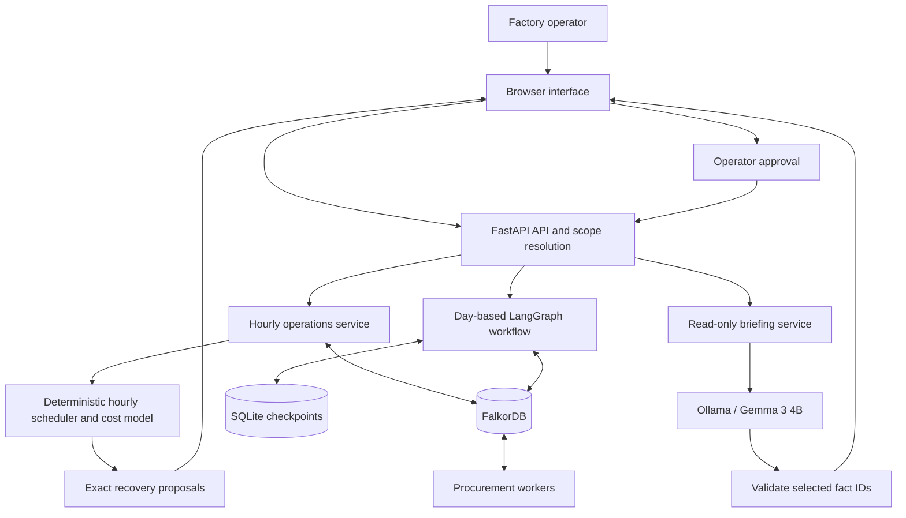
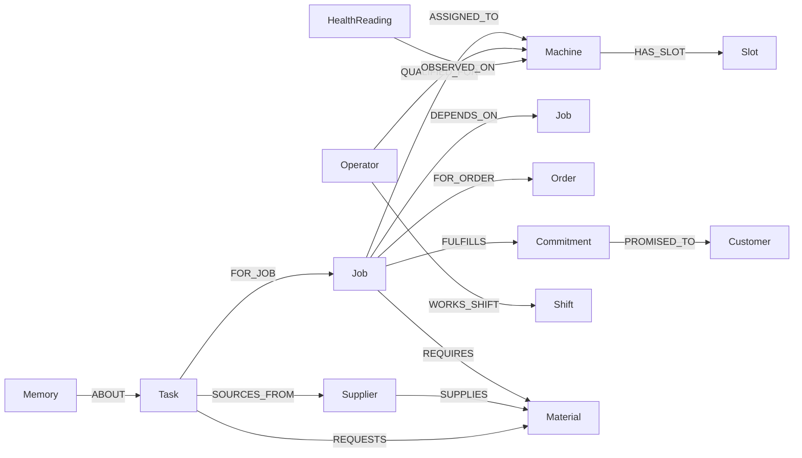
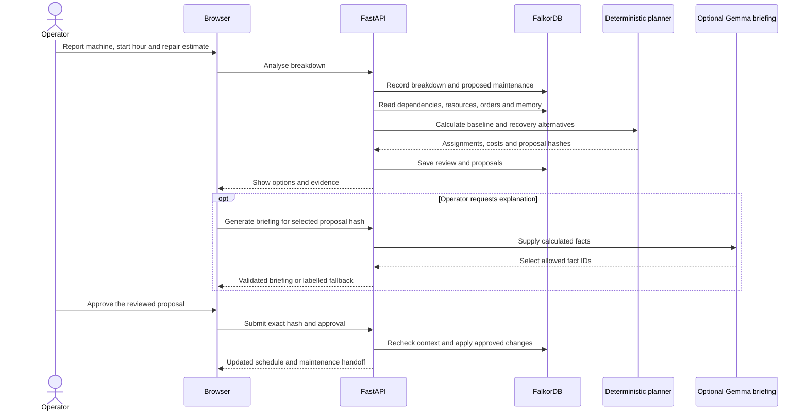
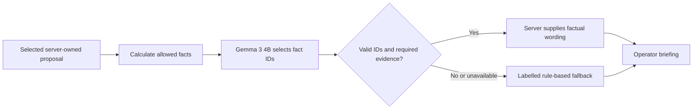
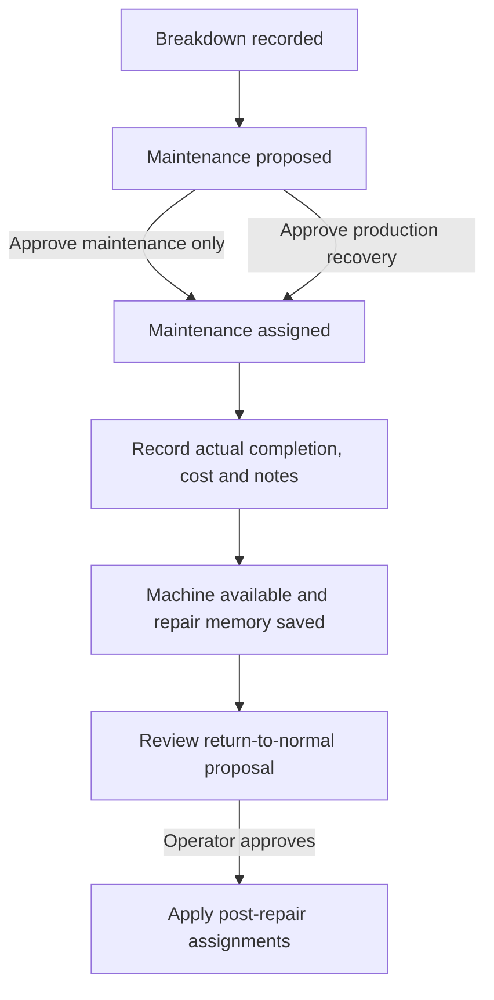

# FactoryGraph

### When a machine stops, understand the impact before making the next move.

FactoryGraph is a factory operations copilot for small manufacturers. It connects machines, production stages, qualified workers, materials and customer orders in **FalkorDB**, traces the consequences of a breakdown, calculates feasible recovery options and estimated financial exposure, and lets an operator approve the response.

**Connected factory context · Deterministic planning · Human approval · Sourced memory · Local Gemma briefings**

> This repository contains a working local demonstration with synthetic factory data. Financial results are estimates from configured rates. Machine-health readings are explicitly simulated.

---

## Contents

- [The problem](#the-problem)
- [What FactoryGraph does](#what-factorygraph-does)
- [Screenshots](#screenshots)
- [Architecture](#architecture)
- [Technology stack](#technology-stack)
- [Graph data model](#graph-data-model)
- [Recovery workflow](#recovery-workflow)
- [Scheduling and financial calculations](#scheduling-and-financial-calculations)
- [Gemma and the AI boundary](#gemma-and-the-ai-boundary)
- [Memory, maintenance and procurement](#memory-maintenance-and-procurement)
- [Installation](#installation)
- [Configuration](#configuration)
- [Complete demo walkthrough](#complete-demo-walkthrough)
- [Interface guide](#interface-guide)
- [API reference](#api-reference)
- [Command-line tools](#command-line-tools)
- [Repository structure](#repository-structure)
- [Testing and verification](#testing-and-verification)
- [Persistence and shop isolation](#persistence-and-shop-isolation)
- [Troubleshooting](#troubleshooting)
- [Current limits](#current-limits)

## The problem

A broken machine rarely affects just one task. Cutting may stop, inspection may wait, workers may become idle, and a customer order may miss its deadline. A replacement machine might exist but be occupied, require a different operator, or lack the necessary material.

A useful recovery decision needs a connected view of the factory, explicit scheduling constraints, transparent cost assumptions and a clear approval boundary.

FactoryGraph helps an operator answer:

1. **What is affected?** Trace the failure through dependent stages and customer promises.
2. **What can actually move?** Check machines, qualified operators, shifts, materials and dependencies.
3. **What might this cost?** Compare estimated exposure under consistent assumptions.
4. **What should happen next?** Review a specific recovery and approve production changes.
5. **What can the next incident learn?** Retain sourced repair and supplier observations.

## What FactoryGraph does

| Capability | Implemented behavior |
|---|---|
| Connected impact analysis | Follows recorded dependencies and exposes machine-to-job-to-customer paths |
| Hourly recovery planning | Finds bounded, feasible whole-hour assignments for affected work |
| Recovery alternatives | Compares waiting for repair, regular capacity and permitted overtime |
| Financial exposure | Separates downtime, idle labour, overtime, changeovers, repair labour and delay penalties |
| Customer risk | Shows order value, promised completion, projected finish and late-hour penalties |
| Human control | Applies only a reviewed proposal with the matching hash and valid context |
| Maintenance | Creates repair tasks, records actual outcomes and supports post-repair rebalancing |
| Memory | Reuses valid, sourced supplier and repair observations in later calculations |
| Procurement | Coordinates internal material requests through claimable worker handoffs |
| Inventory | Tracks job-linked reservations, receipts, release and consumption |
| Local AI | Uses Gemma 3 4B to select useful briefing points from calculated facts |
| Factory setup | Validates machines, workers, qualifications, orders, production flow and cost policy |
| Isolation | Separates shops, scenarios and configured factory workspaces |

## Screenshots

> **Screenshot 1 — Production floor and factory overview**
>
> Add a screenshot here showing the dashboard, machine assignments and operational summary.

<!-- Replace the placeholder above with this image line after adding the file:

-->

> **Screenshot 2 — Recovery comparison and financial exposure**
>
> Add a screenshot here showing baseline/recovery costs, the component breakdown and order risk.

<!-- Replace the placeholder above with this image line after adding the file:

-->

**Adding images:** save screenshots as `docs/images/overview.png` and `docs/images/recovery.png`, then uncomment the matching image lines above. Alternatively, drag images into GitHub's README editor and replace the placeholders with the generated links. `docs/images/` is allowed by `.gitignore`; local reports and development screenshots elsewhere in `docs/` remain excluded.

## Architecture

The browser presents factory state and review controls. FastAPI resolves the shop/factory scope and calls the operational service. FalkorDB holds connected operational facts and handoffs. The hourly scheduler computes assignments and costs directly; the original day-based workflow uses LangGraph with SQLite checkpoints.



### Two scheduling paths

| Area | Hourly operations | Original day-based workflow |
|---|---|---|
| Main use | Costed recovery and repair lifecycle | Sample scenarios, durable investigation and procurement |
| Scheduling unit | Whole clock hours | Relative day buckets |
| Implementation | `operations.py`, `hourly.py` | `workflow.py`, `planner.py`, `agents.py` |
| Persistence | Reviews, proposals and events in FalkorDB | FalkorDB plus LangGraph SQLite checkpoints |
| Human approval | Proposal hash and current context checked again | LangGraph interrupt/resume plus proposal verification |
| Optional AI | Gemma fact-selection briefing | Bounded tool selection and validated-plan recommendation |

Opening hourly operations enriches an original synthetic shop with hourly context. New factories are created directly in hourly mode. An hourly workspace rejects day-based scheduling writes to protect explicit clock-time assignments.

### What lives where

- **FalkorDB:** machines, jobs, workers, qualifications, orders, dependencies, materials, reservations, proposals, decisions, maintenance, health samples and sourced memories.
- **SQLite:** resumable LangGraph checkpoints for the original day-based workflow, scoped by graph.
- **Browser state:** current navigation, selected review/proposal and workspace selection. Access tokens stay in page memory.
- **Ollama:** local model inference, separate from schedules, financial totals and operational state.

## Technology stack

| Layer | Technology | Purpose |
|---|---|---|
| Frontend | HTML, CSS, vanilla JavaScript | Dashboard, graph/path inspection, setup and approval controls |
| API | FastAPI | Validated requests, shop scoping and application endpoints |
| Validation | Pydantic | Factory schemas, identifiers, references and input checks |
| Operational graph | FalkorDB | Connected context, state, decision records and coordination |
| Workflow | LangGraph | Original investigation, scheduling, approval and procurement stages |
| Checkpoints | SQLite | Durable workflow pause/resume |
| Scheduling | Python bounded exact search | Constraint-respecting recovery alternatives |
| Local AI runtime | Ollama | Runs the optional Gemma models |
| Briefing model | Gemma 3 4B | Selects relevant allowed facts for an operator briefing |
| Packaging | Docker and Compose | App/database services and persistent volumes |
| Development | uv, pytest, Ruff | Dependency locking, tests and linting |

No external model API key is required for the local Ollama setup.

## Graph data model

Relationships represent scheduling and operational constraints. Machines connect to assigned jobs, jobs depend on earlier jobs, operators qualify for particular machines, and orders connect production to customer deadlines.



Additional records capture hourly reviews/proposals, breakdowns, maintenance tasks, factory registrations and cost policies. The diagram highlights principal connections rather than every internal label.

**Example:** if inspection depends on cutting, a cutting-machine failure can affect inspection and the customer order even when the inspection bench works. The graph supplies that dependency path; the scheduler checks whether another machine and qualified worker can absorb the work.

## Recovery workflow



Reporting a breakdown is a saved event: the machine becomes unavailable in the model and a proposed maintenance task is created. Production assignments change only after approval. Rejecting the production proposal does not remove the reported breakdown.

### Approval protection

1. The server constructs a complete proposal and canonical SHA-256 hash.
2. The operator reviews a specific alternative.
3. Approval submits that exact hash.
4. The server checks ownership, status, revision and current planning context.
5. Changed context requires fresh analysis; altered or unoffered proposals are rejected.
6. Repeating an applied approval returns the existing result instead of duplicating work.

The hourly application writes reviewed assignments and related handoffs together in the graph. Inference runs outside the operational lock and has no mutation tools.

## Scheduling and financial calculations

### Scheduling constraints

The hourly planner considers:

- Machine type and suitability of alternatives.
- Operator qualifications and overlapping assignments.
- Existing machine and operator work.
- Regular shifts and separately permitted overtime.
- Recorded outages and expected repair availability.
- Prerequisite completion before downstream work starts.
- Reservations, incoming supplies and supplier readiness.
- Customer deadlines, priority and the planning horizon.

Jobs use whole hours and are non-splittable. An interrupted job restarts in full under the model's assumptions. Search is bounded; failure or budget exhaustion is reported instead of presenting a partial recovery as feasible.

The hourly objective first compares total estimated cost, then priority-weighted lateness, completion times and machine changes. This is bounded optimization on a small model factory, not a claim of industrial-scale optimal scheduling.

### Cost model

Money is stored as **integer paise** and displayed as INR, avoiding floating-point currency totals.

| Component | Calculation / interpretation |
|---|---|
| Equipment downtime | Unavailable regular-shift hours multiplied by the failed machine's configured rate |
| Delay-related idle labour | Distinct waiting hours for original operators, excluding productive assignments elsewhere, multiplied by their rates |
| Overtime premium | Distinct operator-hours outside regular shifts multiplied by the premium |
| Changeovers | Affected jobs moved to another machine multiplied by the changeover cost |
| Estimated repair labour | Reserved repair duration, excluding technician queue time, multiplied by the assumed rate |
| Order delay penalties | Whole clock hours late multiplied by the contractual rate, once per order |

```text
Estimated total = equipment downtime
                + delay-related idle labour
                + overtime premium
                + changeovers
                + estimated repair labour
                + order delay penalties

Estimated cost avoided = baseline estimate - selected recovery estimate
```

Equipment rates must exclude wages to avoid double counting. Rerouting production does not erase the machine's physical downtime cost.

**Order value at risk is separate from estimated loss.** A late INR 40,000 order does not automatically mean an INR 40,000 loss. Its value and modeled delay penalty are displayed separately.

Equivalent cost per outage hour divides the total estimate by the outage duration. It is not a live loss meter. Tax, energy, sunk work and lost margin are outside the current calculation.

### Default CNC example

For a fresh precision-workshop factory, report **CNC One at hour 8 with a two-hour repair estimate**:

| Estimate component | Wait for repair | Standard recovery |
|---|---:|---:|
| Equipment downtime | INR 2,400 | INR 2,400 |
| Delay-related idle labour | INR 600 | INR 300 |
| Overtime premium | INR 0 | INR 0 |
| Changeovers | INR 0 | INR 250 |
| Estimated repair labour | INR 800 | INR 800 |
| Order delay penalties | INR 200 | INR 0 |
| **Estimated total** | **INR 4,000** | **INR 3,750** |

The estimated difference is **INR 250** under these synthetic assumptions. Different configurations, recorded memories or prior schedule changes can produce different results.

## Gemma and the AI boundary

### Gemma 3 4B: grounded recovery briefing

**Generate explanation** runs an optional briefing. The model has a narrow role: prioritize useful points for an operator reviewing a calculated proposal.



Gemma selects summary, trade-off and check IDs from supplied categories. The server rejects unknown IDs, duplicates, malformed output, missing cost-comparison evidence and missing human-approval evidence. Displayed wording comes from calculated facts rather than unrestricted model prose.

| Gemma can | Gemma cannot |
|---|---|
| Prioritize relevant briefing points | Supply new monetary figures |
| Highlight modeled trade-offs | Invent machine/operator availability |
| Select useful operator checks | Modify production assignments |
| Explain through validated fact selections | Approve plans, control machinery or send purchases |

Requests are scoped to a factory-owned review and selected hash. Briefings refer to saved context; they do not override stale-context warnings. Unavailable models, timeouts and invalid selections produce a labelled fallback without blocking the deterministic workflow.

### Optional Gemma 3 270M: day-based investigation

The original day-based workflow optionally uses `OLLAMA_MODEL=gemma3:270m` to select named read-only investigation tools and recommend one already validated alternative. Unknown tool names or proposal hashes are rejected, with deterministic policy fallback.

This is separate from `OLLAMA_BRIEFING_MODEL=gemma3:4b`. The 4B briefing has been live-tested locally; the 270M investigation role has not been live-validated. Leaving `OLLAMA_MODEL` unset keeps the original workflow on its explicit deterministic policy.

## Memory, maintenance and procurement

### Sourced operational memory

| Memory | Stored evidence | Later use |
|---|---|---|
| Supplier observation | Actual received delivery lead, source and validity | Can conservatively increase later material-readiness assumptions |
| Repair observation | Observed duration, reported cost, machine and source | Can extend later repair estimates or raise assumed labour rates |
| Incident / decision history | Reviewed recovery and outcome | Retained context and traceability |
| Procedural context | Sourced recovery guidance | Explains a procedure without executing arbitrary code |

Retrieval uses graph relationships and matching context, not embeddings or continuous model retraining. Records have sources, creation times and validity periods. A past outcome is evidence, not a guarantee.

### Maintenance lifecycle



The maintenance desk models one queued technician. Completion makes the machine available without automatically moving jobs back. A late repair flags intersecting jobs for review. Post-repair comparisons exclude historical downtime/repair costs; a zero restoration estimate does not mean the original breakdown had no cost.

### Procurement and inventory

Approved recoveries can create shared internal material tasks. Workers claim tasks with owner tokens, expiring leases and bounded attempts. Expired work can be reclaimed; exhausted attempts become failed and may be explicitly retried.

- **Expected arrival:** supplier confirmation, not received stock.
- **Received:** actual receipt, credited as a reservation for the linked job.
- **Reserved:** stock held for a specific job.
- **Released:** reserved units returned to available stock.
- **Consumed:** units recorded as used, without returning them to stock.
- **Cancelled request:** closes a task; separate reservations need their own action.

The automatic worker makes the local demo convenient. Drafting an internal handoff does not place an external purchase order.

## Installation

### Prerequisites

| Requirement | Needed for |
|---|---|
| Git | Cloning the repository |
| Docker Desktop with Compose, or Docker engine with Compose | App/database stack |
| Modern browser | Interface |
| Python 3.11+ and uv | Native development and tests |
| Ollama and a downloaded Gemma model | Optional AI briefing |

The Docker image uses Python 3.13. Project metadata supports Python 3.11 and later. Local model speed depends on RAM, CPU/GPU resources, context size and whether the model is already loaded.

### Option A: Docker Compose

```sh
git clone https://github.com/SarveshDujari/FactoryGraph.git
cd FactoryGraph
docker compose up --build -d
```

Open **[http://127.0.0.1:8000](http://127.0.0.1:8000)**.

| Service | Host address | Container address |
|---|---|---|
| Web app | `127.0.0.1:8000` | App port `8000` |
| FalkorDB | `127.0.0.1:6381` | `graph:6379` from the app container |
| Host Ollama | Usually `127.0.0.1:11434` | `host.docker.internal:11434` from the app container |

Useful commands:

```sh
docker compose ps
docker compose logs -f app
docker compose logs -f graph
docker compose down
```

`docker compose down` stops the stack while retaining named volumes. Avoid removing volumes when factory history needs to be preserved.

### Option B: native Python app with Docker database

```sh
git clone https://github.com/SarveshDujari/FactoryGraph.git
cd FactoryGraph
uv sync --locked --extra dev
docker compose up -d graph
uv run uvicorn factory_graph.api:app --host 127.0.0.1 --port 8001
```

Open **[http://127.0.0.1:8001](http://127.0.0.1:8001)**.

The native database default is `127.0.0.1:6381`. Direct loopback avoids the Windows `localhost` fallback delay observed during verification.

### Enable Gemma

Install [Ollama](https://ollama.com), start its service, then download the briefing model:

```sh
ollama pull gemma3:4b
ollama list
```

With Ollama running, generate a proposal in **Exposure** and click **Generate explanation**. The briefing defaults to `gemma3:4b`; no API key is required. Download `gemma3:270m` only if enabling the separate investigation role:

```sh
ollama pull gemma3:270m
```

Docker Desktop's Compose configuration already points `OLLAMA_URL` to the host. On Linux where `host.docker.internal` is unavailable, supply an address reachable from the container or configure a suitable host-gateway mapping. The model download/service is separate from the app container.

## Configuration

`.env.example` documents local options. Docker Compose reads project `.env` substitutions; native Python does **not** automatically load that file.

Create a Compose configuration file:

```powershell
Copy-Item .env.example .env
```

On macOS/Linux use `cp .env.example .env`. Keep actual access tokens out of version control.

| Variable | Default / example | Purpose |
|---|---|---|
| `FALKOR_HOST` | Native: `127.0.0.1`; Compose: `graph` | Database host; Compose explicitly sets its service hostname |
| `FALKOR_PORT` | Native: `6381`; Compose: `6379` | Database port |
| `FALKOR_PASSWORD` | Unset | Optional native client password; the bundled Compose database is not configured with one |
| `FALKOR_GRAPH` | `factory_graph_v2` | Base operational graph namespace |
| `CHECKPOINT_PATH` | Native: `data/checkpoints.sqlite` | LangGraph checkpoint base path; Compose uses `/app/data/checkpoints.sqlite` |
| `PLANNING_DAYS` | `7` | Horizon for newly seeded sample shops, from 1 to 30 days |
| `AUTO_PROCUREMENT` | `1` | Automatically process approved internal handoffs |
| `OLLAMA_URL` | Briefing native: `http://127.0.0.1:11434`; Compose: `http://host.docker.internal:11434` | Model API address; set explicitly to share an address across optional model roles |
| `OLLAMA_BRIEFING_MODEL` | `gemma3:4b` | Hourly briefing model |
| `OLLAMA_MODEL` | Unset; optional `gemma3:270m` | Original investigation/recommendation model |
| `SHOP_TOKENS` | Unset | JSON map of shop names to distinct bearer tokens |
| `RUN_INTEGRATION` | Unset | Set to `1` for real-database tests |

A configured factory's hourly horizon is set through its own setup policy, from 2 to 30 days. Changing `PLANNING_DAYS` does not rewrite an existing factory.

Example native PowerShell session:

```powershell
$env:FALKOR_HOST='127.0.0.1'
$env:FALKOR_PORT='6381'
$env:OLLAMA_URL='http://127.0.0.1:11434'
$env:OLLAMA_BRIEFING_MODEL='gemma3:4b'
uv run uvicorn factory_graph.api:app --host 127.0.0.1 --port 8001
```

Optionally set `$env:OLLAMA_MODEL='gemma3:270m'` before starting the server for day-based model assistance. Smaller-model performance is not part of the verified briefing result.

## Complete demo walkthrough

### 1. Create a fresh factory

Open **Exposure → Configure a factory**. The wizard has four steps:

| Step | What to configure |
|---|---|
| Factory & rates | Name, shifts, permitted overtime, cost policy and assumption source |
| Machines & people | Types/rates, health thresholds, workers and qualified machine IDs |
| Orders & flow | Customer values/deadlines, stages, duration, resources and prerequisites |
| Review & create | Check the configuration before creating an independent workspace |

The server checks identifiers, references, qualification, shift fit, resource overlaps and dependency order. Creation preserves existing workspaces and history.

### 2. Report the breakdown

Use the supplied precision-workshop configuration:

```text
Machine:                 CNC One
Start hour:              8
Estimated repair hours:  2
```

Leave repair-memory consideration enabled, then click **Calculate impact & options**. A fresh factory has no prior repair observations to extend the estimate.

**Time reference:** hour 8 = day 0 at 08:00; hour 11 = day 0 at 11:00; hour 32 = day 1 at 08:00.

### 3. Inspect impact and money

Show the affected stages in **Impact**, using Graph view or Path list. Return to Exposure to compare totals, cost components, assignments and order deadlines. Open **Inspect assumptions & source rates** to explain the figures.

### 4. Generate a Gemma briefing

Click **Generate explanation**. Show the summary, modeled trade-offs and operator checks. A labelled fallback is expected when Ollama is unavailable; it does not stop recovery planning.

### 5. Approve a recovery

Choose an alternative, click **Review costs & approve**, then confirm **Approve & apply**. Only the final approval changes production. Maintenance-only approval is available separately when production changes should wait.

### 6. Record actual repair completion

Click **Record repair completion** on the assigned maintenance card:

```text
Actual completion hour:  11
Reported repair cost:    INR 3,000
Notes:                   Bearing replaced; repair completed in three hours.
```

This saves an observation and makes the machine available. Jobs retain their approved assignments.

### 7. Review return to normal

Click **Review return to normal**, inspect the new proposal and approve if appropriate. Rebalancing is a separate decision; the original cost estimate is retained. **Review record** switches between breakdown and post-repair comparisons.

### 8. Show memory and simulated signals

Open **Memory** to inspect the repair observation and source. **Normal sample** and **Elevated sample** generate labelled temperature/vibration/load readings. A threshold breach suggests inspection; it does not predict failure or stop a machine.

The reference clock and history persist. For another recording from hour 8, create a new factory rather than replaying a finished factory as fresh.

## Interface guide

| Screen / control | What it shows or triggers |
|---|---|
| Floor | Current assignments, operational summary and activity |
| Schedule / Table | Visual day-summary lanes or rows; hourly review shows precise times |
| Impact | Dependency graph, highlighted paths and evidence inspection |
| Exposure | Hourly reporting, costs, order risk, briefing and maintenance |
| Recovery | Original day-based review; duplicate navigation is hidden for hourly factories |
| Materials | Requests, supplier updates, retries, cancellation and reservations |
| Memory | Decisions and sourced operational observations |
| Scenario selector | Independent synthetic situations with retained state |
| Factory selector | Switches between original and configured workspaces |
| Review record | Opens saved breakdown/post-repair comparisons |
| Settings | Optional authenticated shop connection; token remains in page memory |
| Reanalyse changed context | Fresh options after state changes invalidate a pending review |

An empty Materials screen is normal in the CNC example: it has no shortage. Original scenarios include machine outage, cascading dependency, scarce operator, supplier delay memory, impossible capacity and repeated disruption.

## API reference

Interactive FastAPI documentation is at `/docs`; the OpenAPI schema is at `/openapi.json`.

Scoping headers:

```text
Authorization: Bearer <configured-shop-token>  # when SHOP_TOKENS is enabled
X-Scenario: default                          # optional sample scenario
X-Factory: <registered-factory-id>            # optional configured workspace
```

The server resolves these to permitted graph namespaces. Clients cannot select arbitrary graph names.

### Factory and hourly operations

| Method | Endpoint | Purpose |
|---|---|---|
| GET | `/api/board` | Current factory board and shared state |
| GET | `/api/scenarios` | Available sample scenarios |
| GET | `/api/factories` | Original shop and configured workspaces |
| GET | `/api/factories/example` | Valid precision-workshop configuration |
| POST | `/api/factories` | Validate and create a factory |
| GET | `/api/operations` | Hourly state, reviews, maintenance and signals |
| POST | `/api/operations/analyse` | Record a breakdown and calculate alternatives |
| POST | `/api/operations/{breakdown}/reanalyse` | Refresh recovery or request post-repair review |
| POST | `/api/operations/reviews/{review}/decision` | Approve/reject an exact proposal |
| POST | `/api/operations/reviews/{review_id}/briefing` | Read-only briefing for the selected hash |
| POST | `/api/maintenance/{task}/assign` | Approve maintenance alone |
| POST | `/api/maintenance/{task}/complete` | Record actual repair completion |
| POST | `/api/operations/health/simulate` | Save a simulated reading |

Example breakdown body:

```json
{
  "machine": "M1",
  "start_hour": 8,
  "duration_hours": 2,
  "use_memory": true
}
```

Approval body; replace the placeholder with a hash returned by the review:

```json
{
  "hash": "<exact-selected-proposal-hash>",
  "approve": true
}
```

The briefing body contains the selected `hash`, without `approve`. Reanalysis takes `{"restoration": false}` for an open breakdown or `{"restoration": true}` after repair completion.

### Day-based workflow, procurement and inventory

| Method | Endpoint | Purpose |
|---|---|---|
| POST | `/api/incidents` | Start day-based investigation and review |
| GET | `/api/incidents/{thread}` | Retrieve a scoped review |
| POST | `/api/incidents/{thread}/decision` | Resume the approval workflow |
| POST | `/api/procurement/run` | Process pending internal requests |
| POST | `/api/tasks/{task_id}/feedback` | Record expected arrival or actual receipt |
| POST | `/api/tasks/{task_id}/retry` | Retry a failed worker task |
| POST | `/api/tasks/{task_id}/cancel` | Cancel a procurement request |
| POST | `/api/reservations/{reservation_id}/close` | Release or consume a reservation |

Validation failures typically return `422`; operational conflicts such as stale proposals return `409`. Missing/inaccessible records can return `404`. Configured authentication requires a valid token. Refer to `/docs` for exact schemas.

## Command-line tools

Use these with a database accessible through the configured native connection:

```sh
uv run python -m factory_graph seed
uv run python -m factory_graph board
```

These are **day-based commands**, not hourly substitutes:

```sh
uv run python -m factory_graph start --machine M1 --day 0 --until 0
uv run python -m factory_graph decide <thread-id> <proposal-hash> --approve
```

Start returns the review/thread and proposal hashes. Running `decide` without `--approve` rejects the proposal. Use an original day-based shop; hourly workspaces reject day-scheduling writes.

To run procurement separately, set `AUTO_PROCUREMENT=0` on the app before starting it, then use:

```sh
uv run python -m factory_graph procurement --worker worker-a
uv run python -m factory_graph procurement --worker worker-b
```

Each invocation processes available handoffs; these commands do not install a continuously running daemon.

Reproducible synthetic evidence tools:

```sh
uv run python -m factory_graph.demo
uv run python -m factory_graph.benchmark
```

The demo records a supplier receipt, starts another incident in a fresh Python process, and verifies that remembered delivery lead changes readiness. The benchmark compares six scenarios against a limited machine-only baseline and records constraint violations. They use isolated demonstration graphs and write reports under `docs/`; outputs are excluded from version control. Results do not establish real-factory productivity gains.

## Repository structure

```text
FactoryGraph/
├── README.md                       # Setup, architecture, usage and API guide
├── .env.example                    # Configuration examples; no credentials
├── compose.yaml                    # App, graph and persistent volumes
├── Dockerfile                      # Python application image
├── pyproject.toml                  # Package metadata and development tools
├── requirements.txt                # Container dependency installation
├── uv.lock                         # Locked development dependencies
├── docs/
│   └── ARCHITECTURE.md              # Additional design notes
├── src/factory_graph/
│   ├── api.py                      # API, validation and scope resolution
│   ├── store.py                    # Graph access, reservations and worker claims
│   ├── factory_models.py           # Setup schemas and CNC example
│   ├── operations.py               # Hourly reviews, approval and repair lifecycle
│   ├── hourly.py                   # Hourly search and cost model
│   ├── briefing.py                 # Grounded Gemma selection and fallback
│   ├── agents.py                   # Named read-only investigation tools
│   ├── planner.py                  # Day-based recovery solver
│   ├── workflow.py                 # LangGraph workflow and procurement
│   ├── seed.py                     # Base synthetic shop
│   ├── scenarios.py                # Independent sample situations
│   ├── demo.py                     # Cross-process supplier-memory proof
│   ├── benchmark.py                # Synthetic scheduling comparison
│   ├── __main__.py                 # CLI entry point
│   └── static/
│       ├── index.html              # Application shell
│       ├── app.js                  # Shared UI and original workflow screens
│       ├── styles.css              # Core responsive visual system
│       ├── operations.js           # Hourly UI, wizard and briefing
│       └── operations.css          # Hourly panels and wizard styling
└── tests/
    ├── test_recovery.py             # Solver and model fallback
    ├── test_hourly.py               # Hourly constraints and financial components
    ├── test_integration.py          # Graph/workflow integration
    ├── test_upgrade.py              # Workers, inventory, memory and concurrency
    ├── test_api.py                  # Authentication and workflow isolation
    ├── test_operations.py           # Setup, maintenance and hourly API lifecycle
    ├── test_briefing.py             # Grounding and offline fallback
    └── container_smoke.py           # Packaged Linux API smoke script
```

Virtual environments, caches, runtime databases, generated reports and development-only screenshots are excluded from GitHub. `docs/images/` is reserved for the README screenshots you add.

## Testing and verification

Install development dependencies and run unit tests without a database:

```sh
uv sync --locked --extra dev
uv run pytest -m "not integration"
uv run ruff check src tests
uv run ruff format --check src tests
```

For the full real-database suite:

```powershell
docker compose up -d graph
$env:RUN_INTEGRATION='1'
uv run pytest
```

In a POSIX shell, use `RUN_INTEGRATION=1 uv run pytest` after starting the database.

Optional machine-readable output:

```sh
uv run pytest --junitxml=docs/test-results.xml
```

Set `RUN_INTEGRATION=1` in that session if the report should include database tests.

**Latest recorded full local run: 56 tests passed in 14.53 seconds.** This is suite duration on the development machine, not an inference or service-throughput benchmark.

Verified areas include:

- Dependency traversal and graph-derived candidates.
- Hourly scheduling and financial components.
- Hash approval, tampering rejection, stale context and replay.
- Fresh-process resume and competing approvals.
- Worker ownership, lease expiry, exhaustion and retry.
- Supplier receipts, reservation release/consumption and memory reuse.
- Factory setup, tenant isolation and cross-shop denial.
- Maintenance completion, late-repair conflicts and restoration.
- Simulated-health behavior and grounded model fallback.

A real Gemma 3 4B call selected allowed facts for an isolated factory proposal while operational state stayed unchanged. The packaged Linux smoke also passed assets/API, daily approval, procurement/receipt, hourly costs, repair and briefing-endpoint checks. The optional 270M investigation model and production-scale operation are outside that live model check.

## Persistence and shop isolation

Compose creates two named volumes:

| Volume | Contents |
|---|---|
| `graph-data` | FalkorDB data with append-only persistence |
| `workflow-data` | SQLite workflow checkpoints |

The base graph is `factory_graph_v2`. Scenarios use separate namespaces; configured factories receive registered independent graphs. With `SHOP_TOKENS` enabled, bearer-token identity resolves the shop before factory lookup. A factory registered to one shop is unavailable to another.

Per-graph Redis locks and revisions protect operational writes. Lock leases are bounded; this is a local/single-service concurrency design, not distributed fencing or a cross-database transaction system. Back up the graph and checkpoints consistently.

Bundled ports bind to loopback. Public deployment needs a deliberate design including TLS, proper secret management and a stronger account/operational model appropriate to the environment.

## Troubleshooting

| Symptom | What to check |
|---|---|
| Docker cannot reach the engine | Start Docker Desktop and wait until the engine is ready |
| App cannot connect to FalkorDB | Check Compose status, database logs, native port `6381` and port conflicts |
| Native requests are slow on Windows | Use `FALKOR_HOST=127.0.0.1` rather than `localhost` |
| Another container occupies 6381 | Reuse the intended database or change port mapping and native settings consistently |
| Briefing shows rule-based fallback | Check Ollama, `ollama list`, `gemma3:4b` and API reachability from the app environment |
| Ollama works natively but not in Docker | Container loopback is the container itself; check the host-reachable address |
| First briefing is slow | Ollama may be loading the model; inference has a bounded timeout/fallback |
| Proposal says context changed | Reanalyse and review the new proposal instead of reusing the old hash |
| No feasible recovery | Inspect constraints/notes; maintenance-only approval may still be available |
| Finished demo cannot restart at hour 8 | Reference time persists; create a fresh factory |
| Restoration shows zero cost | Historical costs are excluded; inspect the original Review record |
| Materials is empty | The selected factory may have no shortage; this is expected in the CNC example |
| Environment changes seem ignored | Native variables must be set before startup; reapply Compose configuration to containers |
| Reports/screenshots do not appear in Git | Reports are ignored; README screenshots belong under `docs/images/` |

## Current limits

| Area | Current boundary |
|---|---|
| Hourly search | Up to 12 affected jobs and 100,000 visits |
| Day-based search | Up to 40 affected jobs and 200,000 visits |
| Scale | Small synthetic scenarios; no production throughput claim |
| Time | Whole hours/day buckets; no detailed holiday/transit calendar |
| Work splitting | Non-splittable; interrupted hourly jobs restart in full |
| Finance | Estimates; excludes tax, energy, sunk work and lost margin |
| Maintenance | One modeled technician queue; no physical dispatch integration |
| Signals | Generated threshold samples, not live telemetry or failure prediction |
| AI briefing | Bounded fact selection, not unrestricted chat/autonomous control |
| Setup | New validated workspaces, not a live-factory import/migration system |
| Procurement | Internal records, no external purchase execution |
| Authentication | Optional static tokens, not a full account product |
| Coordination | No distributed transaction across graph and SQLite |

Built with substantial Codex assistance. Model behavior, synthetic benchmarks and local checks should not be represented as real-factory performance or organiser-confirmed hackathon eligibility.
